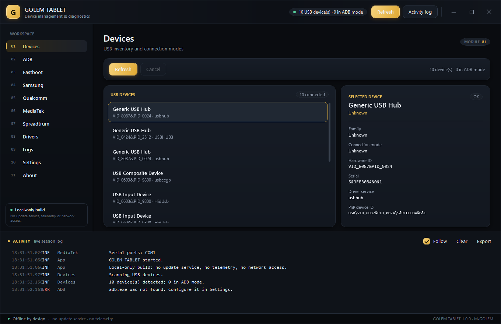
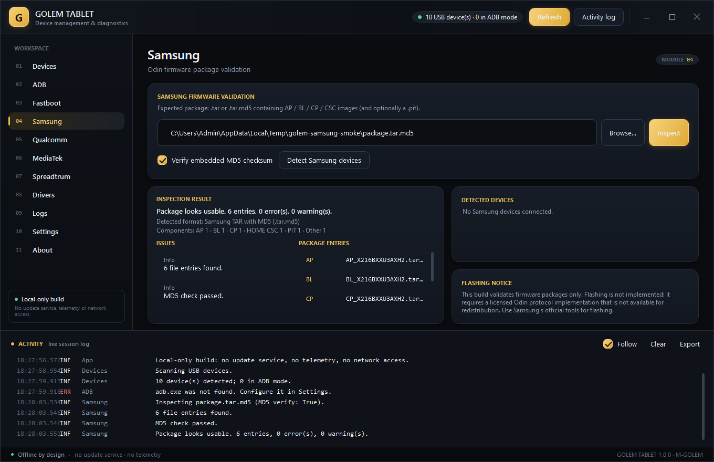
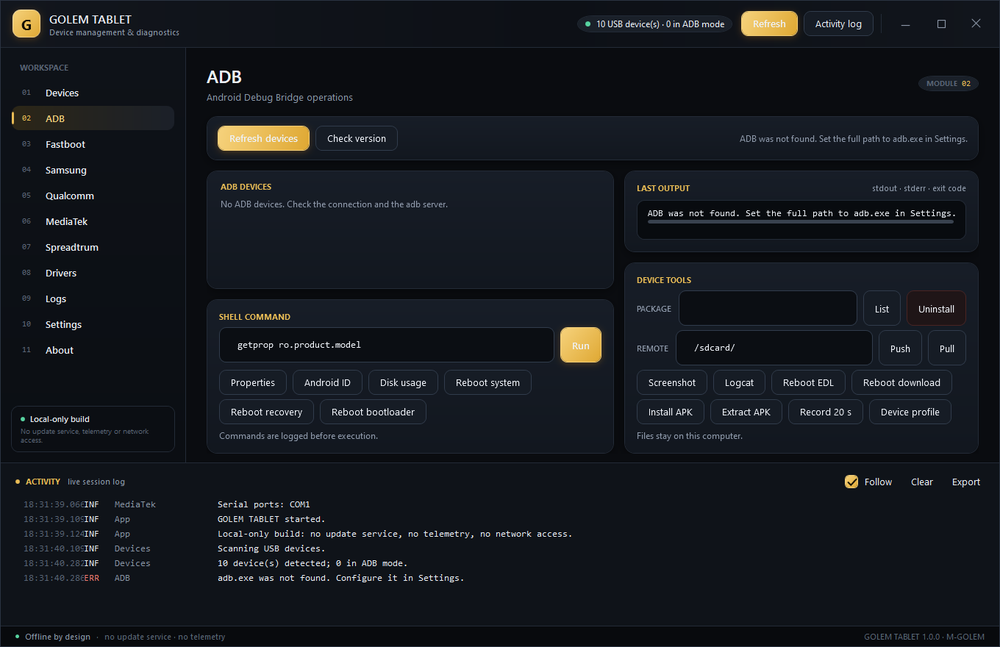
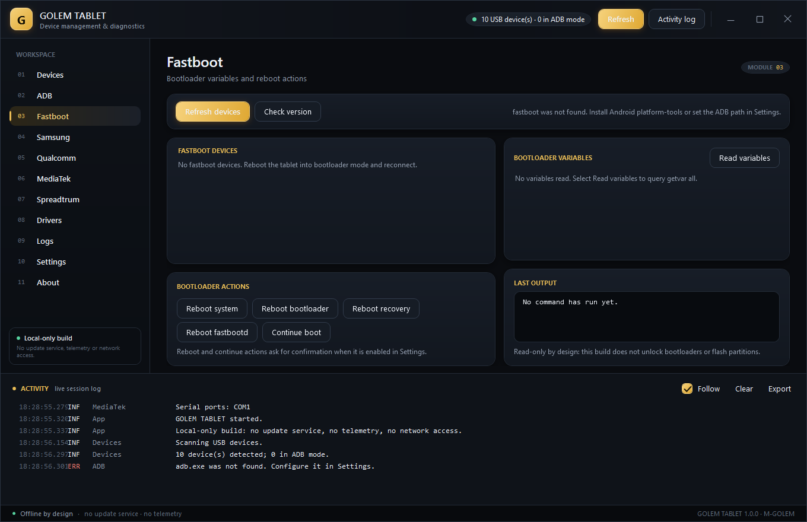
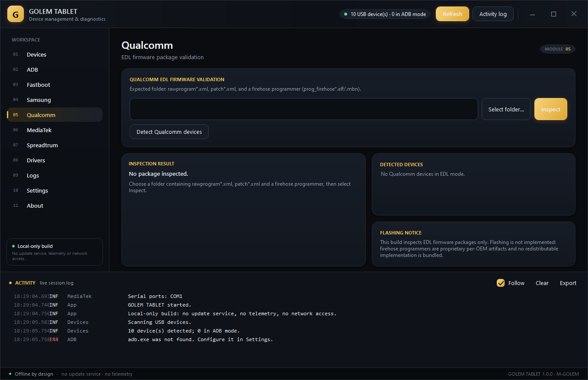
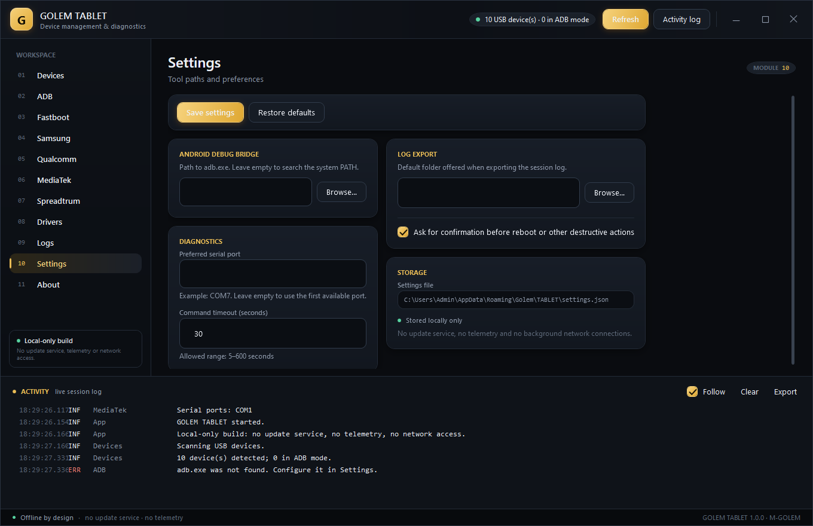
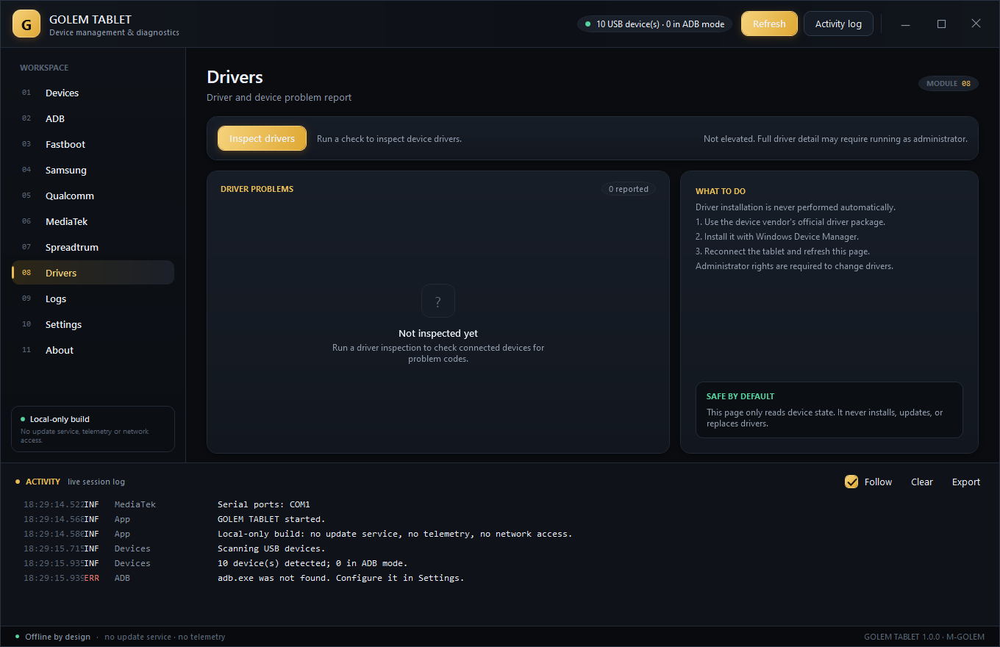
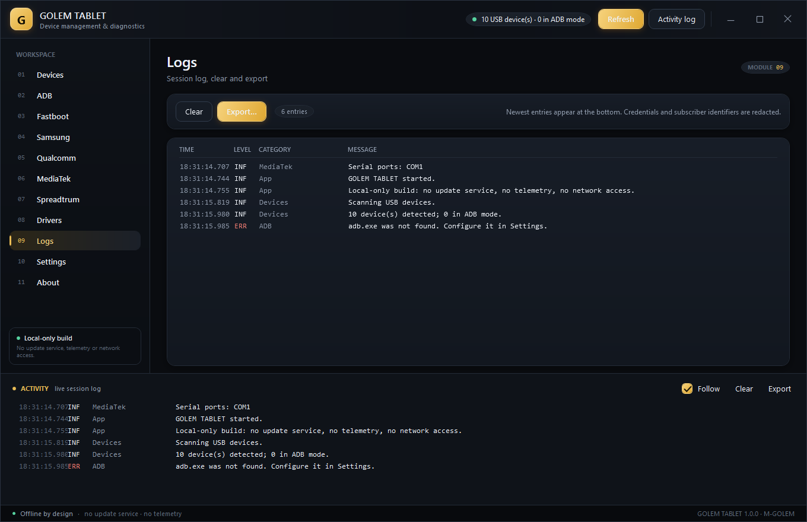

# GOLEM TABLET

Windows desktop tooling for Android tablet diagnostics: USB device inventory,
ADB operations, AT-command diagnostics, driver inspection, firmware-package
validation, and a local session log.

Developed by [M-GOLEM](https://github.com/M-GOLEM).

GOLEM TABLET is a clean-room implementation. It does not contain code, assets,
binaries, or UI resources from any third-party flashing utility, and it is not
affiliated with any device vendor.



## What it does

| Module | Capability |
|---|---|
| **Devices** | Enumerates USB/PnP devices, classifies the connection mode (ADB, fastboot, Samsung download, Qualcomm EDL, MediaTek preloader, serial/AT, mass storage), shows identity and driver status |
| **ADB** | Finds `adb.exe` (configured path or `PATH`), lists devices, runs curated diagnostics, shell commands and reboot actions (system / recovery / bootloader / EDL / download), lists and uninstalls packages, installs or extracts APKs, captures screenshots and 20-second screen recordings, reads a parsed device profile, pushes and pulls files |
| **Fastboot** | Finds `fastboot.exe` beside `adb.exe` or on `PATH`, lists bootloader devices, reads `getvar all` into a key/value table, reboots to system / bootloader / recovery / fastbootd, continues boot; never flashes |
| **Samsung** | Validates `.tar` / `.tar.md5` firmware packages: TAR walk, AP/BL/CP/CSC component classification, embedded MD5 verification (see screenshot below) |
| **Qualcomm** | Validates EDL firmware folders: `rawprogram*.xml`, `patch*.xml`, declared partitions, firehose programmer |
| **MediaTek** | AT console over a COM port with presets (identity, model, revision, serial, signal, registration) |
| **Spreadtrum** | Detects Spreadtrum devices and reports connection state |
| **Drivers** | Reads `ConfigManagerErrorCode` for USB devices, explains problems, reports elevation state, never installs anything |
| **Logs** | Timestamped, severity-filtered session log with redaction of credentials and subscriber identifiers; clear and export |
| **Settings** | ADB path, preferred serial port, command timeout, log export folder, destructive-action confirmation; stored locally |



| | |
|---|---|
|  |  |
|  |  |
|  |  |

## Requirements

- Windows 10 1607 or later (x64)
- Either the [.NET 8 Desktop Runtime](https://dotnet.microsoft.com/download/dotnet/8.0)
  or a self-contained build
- Optional: `adb.exe` and `fastboot.exe` from the Android SDK platform-tools
- Optional: vendor USB/modem drivers for device-specific modes

Administrator rights are **not** required to start. Driver detail may be reduced
without elevation; the application reports that state instead of elevating itself.

## Build

```powershell
dotnet build .\Golem.Tablet.sln -c Release
dotnet test  .\Golem.Tablet.sln -c Release
dotnet run   --project .\src\Golem.Tablet\Golem.Tablet.csproj -c Release
```

Self-contained publish:

```powershell
dotnet publish .\src\Golem.Tablet\Golem.Tablet.csproj `
  -c Release -r win-x64 --self-contained true -o .\artifacts\win-x64
```

Detailed instructions, prerequisites and troubleshooting: [docs/BUILD.md](docs/BUILD.md).

## Project layout

```text
src/
  Golem.Tablet/          WPF application (views, view models, MVVM, theme)
  Golem.Tablet.Core/     UI-free services: devices, ADB, AT, drivers, firmware, logs, settings
  Golem.Tablet.Tests/    xUnit tests for the pure logic
docs/                    Architecture, features, dependencies, build, implementation plan
```

Architecture and design decisions: [docs/ARCHITECTURE.md](docs/ARCHITECTURE.md).

## Privacy and network behaviour

- No update service, no updater, no telemetry, no analytics, no crash reporting.
- No HTTP/TCP client anywhere in the application. Settings and logs are local files.
- The only outbound action is opening the project URL in the default browser when
  the user explicitly clicks **Open GitHub profile** on the About page.

## What is not implemented

Flashing (Samsung Odin, Qualcomm firehose, Spreadtrum download mode) is **not**
implemented. Each of those workflows depends on proprietary, per-OEM tooling or
protocol details that cannot be reproduced or redistributed here, so the
application validates packages and detects devices instead of pretending to
flash them. The affected pages state this explicitly.

See [docs/FEATURES.md](docs/FEATURES.md) for the per-feature status table,
including which items were verified on real hardware and which were not.

## Status

Version 1.0.0. Built and tested on Windows 10 x64 with .NET SDK 8.0.427.
No Android hardware was attached during verification; hardware-dependent paths are
marked as untested in the feature table.

## Licence

MIT — see [LICENSE](LICENSE). Third-party notices are in
[THIRD-PARTY-NOTICES.md](THIRD-PARTY-NOTICES.md).
